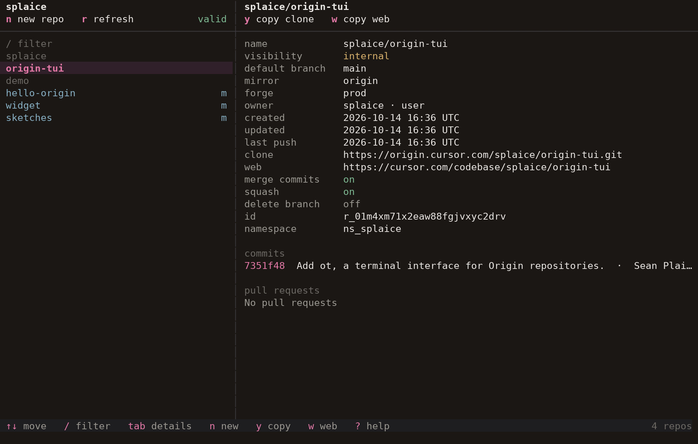

# ot

A full-screen terminal interface for [Cursor Origin](https://cursor.com) repositories. The left column is the signed-in account and its repos. The right column is the selected repo: settings, clone and web URLs, branches, recent commits, and pull requests.



`ot` talks to the `origin` CLI. It does not replace `git`.

## Run

`origin` needs to be on `PATH`, or `ORIGIN_BIN` needs to point at it. Otherwise `ot` looks in `~/.local/bin/origin`.

```sh
cargo run --release
```

The binary is `target/release/ot`.

Syncing a repository out to GitHub also needs the [GitHub CLI](https://cli.github.com/) (`gh`), signed in, and SSH access to `git@github.com`.

## Layout

The header on the left holds account actions. The header on the right holds actions for the selected repository. A narrow window hides the less common actions; the keys still work.

The list groups repositories by owner when more than one owner is present. An `m` after a name means the repository is a GitHub mirror, and those names use a cooler color. Visibility sits in front of the name:

| Mark | Visibility |
| --- | --- |
| `+` | public |
| `·` | private |
| `~` | internal |

## Keys

| | |
| --- | --- |
| Move | `↑` `↓` `j` `k` |
| Page | `pgup` `pgdn` `ctrl-u` `ctrl-d` |
| Jump | `g` `G` `home` `end` |
| Panes | `tab` `←` `→` |
| Filter | `/` |
| New repository | `n` |
| Mirror from GitHub | `m` |
| Sync to GitHub | `s` |
| Delete repository | `d` |
| Delete branch | `x` |
| Refresh | `r` |
| Copy the focused value | `y` or `enter` |
| View `README.md` | `enter` on that row |
| Copy the web URL | `w` |
| Edit the focused setting | `e` |
| Select visible text | drag |
| Copy a field value | double-click |
| Close a dialog | `esc` |
| Quit | `q` or `ctrl-c` |
| Help | `?` |

`/` filters by repository name. A query that contains `/` also matches `owner/name`.

## Repositories

`n` creates a repository with `origin repo create`.

`y` or `enter` copies the focused value. `w` copies the web URL (`https://cursor.com/codebase/{owner}/{repo}`). The clone URL is `https://origin.cursor.com/{owner}/{repo}.git`. A drag copies the visible text. Every copy also lands on the system clipboard and in `~/.origin-tui/last-copy.txt`.

`e` edits the focused setting: visibility (`internal` or `private`), the default branch, merge commits, squash merges, and deleting the branch after a merge. Merge commits and squash merges are saved together, and at least one stays on. `enter` saves. `esc` cancels. A personal-account repository can reject `internal`; the API error is shown in the dialog.

When the selected branch has a `README.md`, that row appears under the repository fields. `enter` or a double-click opens it formatted. `y` copies the original Markdown.

Branches appear when the repository has more than one. Focusing a branch loads its latest commits (up to 20) and its README. Pull requests are read-only.

## GitHub

`m` mirrors a GitHub repository into Origin. GitHub stays the source. The created name is `{namespace}/{github-repo}`.

`s` syncs an Origin repository out to a GitHub child. Origin stays the source. The form takes `owner/repo` and a visibility used only when the GitHub repository has to be created. The mapping is saved in `~/.origin-tui/children.json`, then `ot` pushes a mirror of the Origin repository to `git@github.com:owner/repo.git`. That push removes branches and tags that exist only on GitHub. A repository that is already a GitHub mirror is refused, because GitHub is already the source.

## Deleting

`d` deletes the Origin repository. The dialog asks for the exact `owner/name`. A mirrored repository's GitHub source is left as it is.

`x`, with a branch focused, deletes that branch on Origin. The dialog asks for the exact branch name. The default branch cannot be deleted, and a branch on a GitHub mirror has to be deleted on GitHub. Pull requests headed by the branch are closed by Origin.
